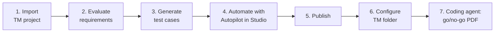

# Welcome to the Coding Agents for Test Workshop

**Thank you for joining the UiPath Coding Agents for Test Workshop!**

This **Learner's Handbook** is your hands-on guide for the workshop. We keep the theory short and get you building fast: in a few hours you'll take a set of requirements all the way to an automated regression run, and finish by asking a coding agent for a **go/no-go release report** in plain English.

!!! info "Before the workshop"
    Complete the **[Prerequisites](module-0-prerequisites/index.md)** before the session starts. Installing the tools takes about 30–45 minutes, and the hands-on steps depend on them.

    Your **trainer will share the organization and tenant** you'll use during the workshop.

## What You'll Build

You'll walk through the full testing lifecycle in UiPath Test Cloud, with AI at every step:

1. **Import a Test Manager project** — your workspace for the day.
2. **Evaluate requirements** — let Autopilot check them for clarity, completeness, and testability.
3. **Generate test cases** — let Autopilot design test cases from the requirements.
4. **Automate with Autopilot in Studio** — turn manual test cases into automated ones.
5. **Publish** — send the automations to Orchestrator so Test Manager can run them.
6. **Configure the Test Manager folder** — give the project a folder and a robot to execute on.
7. **Coding agent: go/no-go report** — ask a coding agent to run the regression test set and produce a release-ready PDF report.

## Learning Objectives

By the end of this workshop, you will:

✅ Import a test project into Test Manager and find your way around it

✅ Use Autopilot for Testers to evaluate requirements and generate test cases

✅ Automate test cases in Studio with Autopilot for Developers and publish them to Orchestrator

✅ Configure a Test Manager project so its test sets can run automatically

✅ Set up a coding agent (Claude Code or OpenAI Codex) with the UiPath CLI and skills

✅ Ask a coding agent to trigger a test set, analyze the results, and produce a go/no-go release report

**Real deliverable:** By the end of the workshop, you'll have a **PDF release report** with a go/no-go recommendation, generated by a coding agent from a real regression run in your own Test Manager project.

## How This Guide Is Organized

| Section | What's inside |
|---|---|
| **[Prerequisites](module-0-prerequisites/index.md)** | Accounts, coding agent concepts, and step-by-step installation |
| **[Introduction](module-1-introduction/index.md)** | A short tour of Test Cloud, Test Manager, and Coding Agents for Test |
| **[Hands-On Workshop](module-2-hands-on-workshop/index.md)** | The seven hands-on steps, from import to the go/no-go report |
| **[Troubleshooting & Next Steps](module-3-troubleshooting-and-next-steps/index.md)** | More prompts to try and fixes for common problems |

---

[Next → Prerequisites](module-0-prerequisites/index.md){: .md-button .md-button--primary}

---

!!! quote "Here's something worth holding onto as you work through this workshop"
    Coding agents don't replace testers — they give testers a new way to work. Instead of clicking through dashboards to find out what failed and why, you ask a question in plain English and get an answer grounded in your real test data.

    Robots bring determinism and control, agents bring adaptability and reasoning. **This workshop is about putting the two together.**
