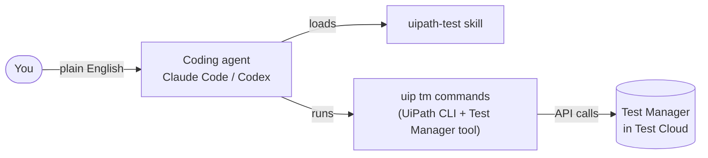

# Prerequisites

Complete this section **before the workshop**. It covers the accounts you need, the ideas behind coding agents, and how UiPath connects to them. The **[Installation Guide](01-installation-guide.md)** then walks you through every install.

## Accounts and access

!!! info "Provided by your trainer"
    Your trainer will share the **organization** and **tenant** for the workshop, and make sure your user has access. You'll need them to sign in to Test Cloud and to log in from the UiPath CLI.

Before the workshop, confirm that you can:

✅ Sign in to <a href="https://cloud.uipath.com" target="_blank">UiPath Automation Cloud</a> and open the workshop **organization** and **tenant** shared by your trainer

✅ Open **Test Manager** and **Orchestrator** in that tenant

✅ Use **Autopilot** in Test Manager and Studio (enabled on the workshop tenant)

✅ See a **machine with an App Test Robot runtime** you can add to your folder (we set this up together in step 8)

## What's a coding agent?

A coding agent is an AI assistant that understands a goal described in plain English, explores your files and tools, and gets the work done — not just autocomplete.

Examples of coding agents:

✅ **Claude Code** (Anthropic)

✅ **Codex CLI** (OpenAI)

✅ Cursor, Gemini CLI, GitHub Copilot Agent

This workshop supports **Claude Code** and **OpenAI Codex**. Install one of them, or both.

### Core concepts

| Concept | What it is |
|---|---|
| **Tools** | Built-in actions the agent can take, such as reading files, running terminal commands, searching the web, and editing code |
| **Skills** | Bundles of domain knowledge the agent loads automatically when a task matches |
| **Commands** | Shortcuts you trigger yourself, such as `/clear` or `/help` |
| **Hooks** | Automatic actions at points in the agent's lifecycle, often used as guardrails |
| **Subagents** | Specialized workers the agent can hand tasks to |
| **Plugin** | A package that bundles skills, commands, hooks, and subagents together |

A **skill** is a folder containing a `SKILL.md` file. It describes when the skill applies, step-by-step instructions, and references to supporting documentation. The agent reads it only when it needs it.

## Coding agents and UiPath

UiPath provides a **plugin** for coding agents with 20+ skills for UiPath products. In this workshop you'll use one of them:

✅ **`uipath-test`** — teaches the agent how to work with Test Manager: read test cases and results, trigger test sets, monitor executions, and report on them.

Other skills in the plugin include `uipath-rpa` (Studio workflows), `uipath-agents` (low-code and coded agents), `uipath-platform` (Orchestrator and authentication), and `uipath-maestro-flow` (Flow projects).

### The `uip` CLI

The **UiPath CLI** (`uip`) is the bridge between your machine and your UiPath organization. It handles authentication and talks to UiPath services. Two kinds of extensions build on it:

✅ **Tools** add commands for UiPath services. The **Test Manager tool** adds the `uip tm` commands.

✅ **Skills** teach the coding agent when and how to use those commands.

!!! note "Public Preview"
    Coding Agents for Test is in **Public Preview**. Commands and skill behavior may change before General Availability, so keep the CLI and skills up to date.

---

[Next → Installation Guide](01-installation-guide.md){: .md-button .md-button--primary}

---
