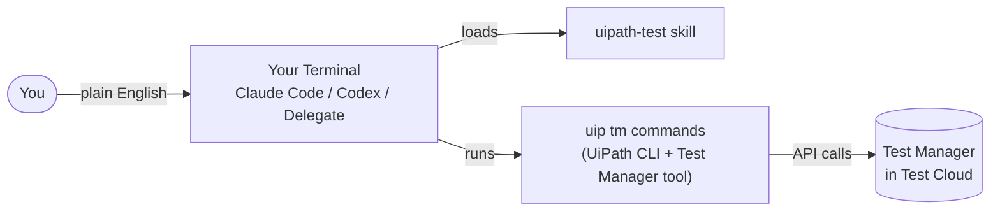

# Prerequisites

Complete this section **before the workshop**. It covers the accounts you need, the ideas behind coding agents, and how UiPath connects to them. The **[Installation Guide](01-installation-guide.md)** then walks you through every install.

## Accounts and access

!!! info "Provided by your trainer"
    Your trainer will share the **organization** and **tenant** for the workshop, and make sure your user has access. You'll need them to sign in to Test Cloud and to log in from the UiPath CLI.

Before the workshop, confirm that you can:

✅ Sign in to <a href="https://cloud.uipath.com" target="_blank">UiPath Automation Cloud</a> and open the workshop **organization** and **tenant** shared by your trainer

✅ Open **Test Manager** and **Orchestrator** in that tenant

✅ Use **Autopilot** in Test Manager and Studio (enabled on the workshop tenant)

✅ See a **machine with an App Test Robot runtime** you can add to your folder (we set this up together in step 9)

✅ Have an **App Test Developer** license — you need it to create Test Automation projects

✅ Have **permission to create Data Fabric entities** — you need it for test data in step 7

## What's a coding agent?

A coding agent is an AI assistant that understands a goal described in plain English, explores your files and tools, and gets the work done — not just autocomplete.

Popular coding agents include **Claude Code** (Anthropic), **Codex CLI** (OpenAI), Cursor, Gemini CLI, and GitHub Copilot Agent.

!!! success "UiPath Delegate — join the workshop without a coding agent license"
    **UiPath Delegate** is UiPath's own desktop assistant. Like a coding agent, it understands goals described in plain English and gets the work done — and its tools are built to work across your **whole desktop**, not just a terminal or an IDE.

    ✅ **No Claude, OpenAI, or other coding agent license needed.** **Delegate for Testing** runs on your **Test Cloud** license (App Test Developer or App Tester), so you don't have to buy or set up a third-party AI subscription to attend the workshop.

    ✅ **Easy to start** — no separate AI tool, sign-in, or plugin to set up.

    
### Core concepts

| Concept | What it is |
|---|---|
| **Tools** | Built-in actions the agent can take, such as reading files, running terminal commands, searching the web, and editing code |
| **Skills** | Bundles of domain knowledge the agent loads automatically when a task matches |
| **Commands** | Shortcuts you trigger yourself, such as `/clear` or `/help` |
| **Hooks** | Automatic actions at points in the agent's lifecycle, often used as guardrails |
| **Subagents** | Specialized workers the agent can hand tasks to |
| **Plugin** | A package that bundles skills, commands, hooks, and subagents together |

A **skill** is a folder containing a `SKILL.md` file. It describes when the skill applies, step-by-step instructions, and references to supporting documentation. The agent reads it only when it needs it.

## Choose your Terminal

In this workshop, the **Terminal** is where you type requests in plain English and an AI agent does the work for you: it captures UI elements, creates test data, runs test sets, and writes reports. Pick one option below. For the rest of the guide, your choice is simply **the Terminal**.

=== "Claude Code"

    **Claude Code** is Anthropic's coding agent.

    ✅ **You need:** a Claude subscription or an Anthropic API key

    ✅ **You install:** Node.js, the UiPath CLI, Claude Code, and the UiPath skills — see the [Installation Guide](01-installation-guide.md)

    ✅ **It runs in:** Studio's **Terminal** tab, or any other terminal or IDE

=== "OpenAI Codex"

    **Codex CLI** is OpenAI's coding agent.

    ✅ **You need:** a ChatGPT plan or an OpenAI API key

    ✅ **You install:** Node.js, the UiPath CLI, Codex, and the UiPath skills — see the [Installation Guide](01-installation-guide.md)

    ✅ **It runs in:** Studio's **Terminal** tab, or any other terminal or IDE

=== "UiPath Delegate"

    **UiPath Delegate** is UiPath's desktop assistant. With the **QA/Testing** profile, it becomes **Delegate for Testing**.

    ✅ **You need:** your **Test Cloud** license (App Test Developer or App Tester) — no third-party AI license

    ✅ **You install:** UiPath Assistant with Delegate, and the UiPath CLI — see the [Installation Guide](01-installation-guide.md)

    ✅ **It runs in:** its own window, opened from UiPath Assistant

!!! tip "Your choice follows you"
    Once you select a tab, every page in this guide shows the steps for that option. You can switch at any time by selecting another tab.

### Open your Terminal

Whenever a step says **open your Terminal**, do this:

=== "Claude Code"

    1. In Studio, select the **Terminal** tab in the bottom panel. It opens in your project folder.

        

    2. Start Claude Code:

        ```powershell
        claude
        ```

        The first time you start Claude Code in a folder, it asks whether you trust it. Select **Yes, I trust this folder** and press **Enter**.

        

    ✅ **New session:** type `/clear`.

    ✅ **Approvals:** Claude Code asks before running commands. **Auto mode** (press **Shift+Tab** to cycle modes) runs them without asking — leave it off if you'd rather read each command first.

    ??? tip "Using another terminal or IDE?"
        Open your Studio project folder first, then start `claude` there:

        ```powershell
        cd "$HOME\Documents\UiPath\<project name>"
        ```

=== "OpenAI Codex"

    1. In Studio, select the **Terminal** tab in the bottom panel. It opens in your project folder.

        

    2. Start Codex:

        ```powershell
        codex
        ```

    ✅ **New session:** type `/clear`, or close Codex and start it again.

    ✅ **Approvals:** Codex may ask before running commands. Read and approve each `uip` command as it comes.

    ??? tip "Using another terminal or IDE?"
        Open your Studio project folder first, then start `codex` there:

        ```powershell
        cd "$HOME\Documents\UiPath\<project name>"
        ```

=== "UiPath Delegate"

    1. Open **UiPath Assistant**, and use the switcher next to the UiPath logo to open **Delegate**.
    2. Press **Ctrl+N** to start a new task.

    ✅ **New session:** press **Ctrl+N**.

    ✅ **Approvals:** with **Adaptive** approval mode, Delegate asks before high-impact actions, such as triggering a test run. Read each approval card before you approve it.

## Coding agents and UiPath

UiPath provides a **plugin** for coding agents with 20+ skills for UiPath products. In this workshop you'll use three of them:

✅ **`uipath-test`** — works with Test Manager: reads test cases and results, triggers test sets, monitors executions, and reports on them

✅ **`uipath-rpa`** — works with your Studio project: captures UI elements into the Object Repository and links test data to test cases

✅ **`uipath-platform`** — works with UiPath Cloud services, including Data Fabric for test data

Other skills in the plugin include `uipath-agents` (low-code and coded agents) and `uipath-maestro-flow` (Flow projects).

### The `uip` CLI

The **UiPath CLI** (`uip`) is the bridge between your machine and your UiPath organization. It handles authentication and talks to UiPath services. Two kinds of extensions build on it:

✅ **Tools** add commands for UiPath services. The **Test Manager tool** adds the `uip tm` commands.

✅ **Skills** teach the coding agent when and how to use those commands.



!!! note "Public Preview"
    Coding Agents for Test is in **Public Preview**. Commands and skill behavior may change before General Availability, so keep the CLI and skills up to date.

---

[Next → Installation Guide](01-installation-guide.md){: .md-button .md-button--primary}

---
