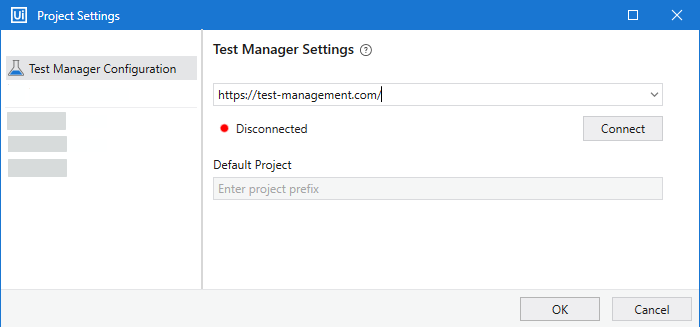
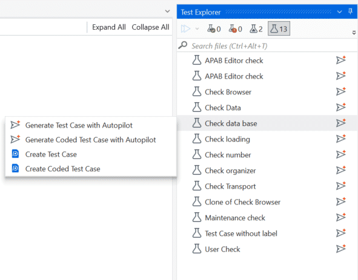

# 04. Connect Studio to Test Manager

## Why connect Studio?

Your test cases live in Test Manager, but automation is built in **UiPath Studio**. Connecting the two lets you see your **manual test cases** inside Studio, automate them, and keep every automation **linked** to its test case. That link is what lets Test Manager — and later a coding agent — run the tests and report on them.

!!! warning "Access required"
    Only **App Test Developer** users can create and publish Test Automation projects. Check with your trainer if you can't create one.

## Part 1 — Open the starter project

The starter project is a **Test Automation** project with an **Object Repository** for the UiBank application already set up. The Object Repository stores the UI elements of the application (buttons, fields, labels), so that automations can find and interact with them reliably.

:material-folder-zip: [**Application Testing ILT - Students.zip**](../assets/Files/Application%20Testing%20ILT%20-%20Students.zip) (302.7 KB) — starter Studio project

1. Download and extract the zip file.
2. Launch **UiPath Studio**.
3. Select **Open Local Project**.
4. Browse to the extracted folder and select the `project.json` file.
5. Click **Open**.

!!! tip "Remember the folder"
    Note where you extracted the project. If you automate with a coding agent in step 5, you'll start the agent in this folder.

## Part 2 — Link Studio to your Test Manager project

!!! example "It's your turn now!"
    1. In the **Design** ribbon, go to **Test Manager → Test Manager Settings**.
    2. Under **Test Manager Configuration**, enter your Test Manager URL from Automation Cloud.
    3. Click **Connect** and sign in.
    4. In **Default Project**, select the project you imported in step 1.
    5. Click **OK**. A green icon shows the connection is working.

## Part 3 — View your manual test cases

Open the **Test Explorer** panel. The test cases you generated in step 3 appear as **manual test cases**: they have steps, but no automation yet.

**Check it:**

✅ The connection icon in Studio is green.

✅ Your test cases from step 3 appear in **Test Explorer**, with the same keys you noted (for example `UIBMK:5`).

## Nice work!

Studio and Test Manager are connected, and your manual test cases are ready to automate.

---

[Next → 05. Automate Test Cases](05-automate-test-cases.md){: .md-button .md-button--primary}

---
