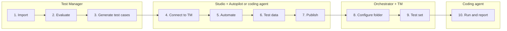

# Hands-On Workshop

This is the core of the day. You'll take a project from requirements to a published, automated test set — then hand over to a coding agent to run it and write the release report.

## What you'll do

✅ Import a project into Test Manager

✅ Evaluate requirements and generate test cases with Autopilot for Testers

✅ Connect Studio to Test Manager and view your manual test cases

✅ Automate at least 2 test cases — with Autopilot in Studio or a coding agent (Claude Code or Codex)

✅ Generate test data with Autopilot or a coding agent

✅ Publish the automations to Orchestrator and configure the project's folder and robot

✅ Group the automated test cases into a smoke or regression test set

✅ Ask a coding agent to run the test set and produce a go/no-go PDF report

!!! info "Before you start"
    Make sure you've completed the **[Setup checklist](../module-0-prerequisites/01-installation-guide.md#setup-checklist)**, and have the **organization and tenant** your trainer shared.

## Steps

- [01. Import the Test Manager Project](01-import-tm-project.md)
- [02. Evaluate Requirements](02-evaluate-requirements.md)
- [03. Generate Test Cases](03-generate-test-cases.md)
- [04. Connect Studio to Test Manager](04-connect-studio-to-tm.md)
- [05. Automate Test Cases](05-automate-test-cases.md)
- [06. Generate Test Data](06-generate-test-data.md)
- [07. Publish Test Cases](07-publish-test-cases.md)
- [08. Configure the Test Manager Folder](08-configure-tm-folder.md)
- [09. Create a Test Set](09-create-test-set.md)
- [10. Run and Report with a Coding Agent](10-run-and-report.md)
- [You Did It!](you-did-it.md)

---

[Next → 01. Import the Test Manager Project](01-import-tm-project.md){: .md-button .md-button--primary}

---
