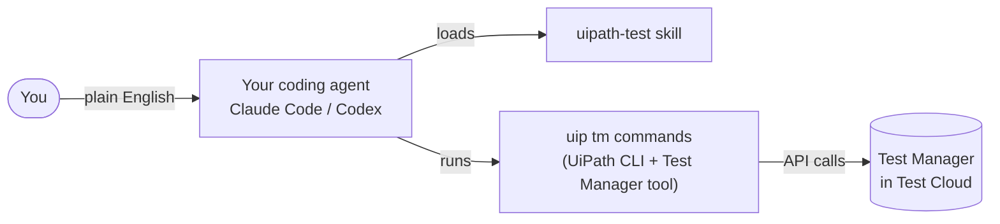

# Use Your Own Coding Agent

!!! info "Optional — not needed for the workshop"
    The workshop uses **Delegate** for every agent step, with nothing extra to install. Read this section only if you'd like to run the same steps with **Claude Code** or **OpenAI Codex**, during the workshop or afterwards.

Every prompt in the workshop works the same way in a coding agent. Wherever a step says **Delegate**, use your coding agent instead.

## What's a coding agent?

A coding agent is an AI assistant that understands a goal described in plain English, explores your files and tools, and gets the work done — not just autocomplete.

Popular coding agents include **Claude Code** (Anthropic), **Codex CLI** (OpenAI), Cursor, Gemini CLI, and GitHub Copilot Agent.

### Core concepts

| Concept | What it is |
|---|---|
| **Tools** | Built-in actions the agent can take, such as reading files, running terminal commands, searching the web, and editing code |
| **Skills** | Bundles of domain knowledge the agent loads automatically when a task matches |
| **Commands** | Shortcuts you trigger yourself, such as `/clear` or `/help` |
| **Hooks** | Automatic actions at points in the agent's lifecycle, often used as guardrails |
| **Subagents** | Specialized workers the agent can hand tasks to |
| **Plugin** | A package that bundles skills, commands, hooks, and subagents together |

A **skill** is a folder containing a `SKILL.md` file. It describes when the skill applies, step-by-step instructions, and references to supporting documentation. The agent reads it only when it needs it.

## Coding agents and UiPath

UiPath provides a **plugin** for coding agents with 20+ skills for UiPath products. The workshop steps use three of them:

✅ **`uipath-test`** — works with Test Manager: reads test cases and results, triggers test sets, monitors executions, and reports on them

✅ **`uipath-rpa`** — works with your Studio project: captures UI elements into the Object Repository and links test data to test cases

✅ **`uipath-platform`** — works with UiPath Cloud services, including Data Fabric for test data

Other skills in the plugin include `uipath-agents` (low-code and coded agents) and `uipath-maestro-flow` (Flow projects).

### The `uip` CLI

The **UiPath CLI** (`uip`) is the bridge between your machine and your UiPath organization. It handles authentication and talks to UiPath services. Two kinds of extensions build on it:

✅ **Tools** add commands for UiPath services. The **Test Manager tool** adds the `uip tm` commands.

✅ **Skills** teach the coding agent when and how to use those commands.



## Choose your coding agent

=== "Claude Code"

    **Claude Code** is Anthropic's coding agent.

    ✅ **You need:** a Claude subscription or an Anthropic API key

    ✅ **You install:** Node.js, Git, the UiPath CLI, Claude Code, and the UiPath skills — see [Setup](01-setup.md)

    ✅ **It runs in:** Studio's **Terminal** tab, or any other terminal or IDE

=== "OpenAI Codex"

    **Codex CLI** is OpenAI's coding agent.

    ✅ **You need:** a ChatGPT plan or an OpenAI API key

    ✅ **You install:** Node.js, Git, the UiPath CLI, Codex, and the UiPath skills — see [Setup](01-setup.md)

    ✅ **It runs in:** Studio's **Terminal** tab, or any other terminal or IDE

## Open your coding agent

Whenever a workshop step says **open Delegate**, do this instead:

=== "Claude Code"

    1. In Studio, select the **Terminal** tab in the bottom panel. It opens in your project folder.

        

    2. Start Claude Code:

        ```powershell
        claude
        ```

        The first time you start Claude Code in a folder, it asks whether you trust it. Select **Yes, I trust this folder** and press **Enter**.

        

    ✅ **New session:** type `/clear`.

    ✅ **Approvals:** Claude Code asks before running commands. **Auto mode** (press **Shift+Tab** to cycle modes) runs them without asking — leave it off if you'd rather read each command first.

    ??? tip "Using another terminal or IDE?"
        Open your Studio project folder first, then start `claude` there:

        ```powershell
        cd "$HOME\Documents\UiPath\<project name>"
        ```

=== "OpenAI Codex"

    1. In Studio, select the **Terminal** tab in the bottom panel. It opens in your project folder.

        

    2. Start Codex:

        ```powershell
        codex
        ```

    ✅ **New session:** type `/clear`, or close Codex and start it again.

    ✅ **Approvals:** Codex may ask before running commands. Read and approve each `uip` command as it comes.

    ??? tip "Using another terminal or IDE?"
        Open your Studio project folder first, then start `codex` there:

        ```powershell
        cd "$HOME\Documents\UiPath\<project name>"
        ```

## Before each agent step

A coding agent works through **your** `uip login` session, not through UiPath Assistant. Before steps 4, 6, 8, and 12, check you're still logged in to the workshop tenant — login tokens expire:

```powershell
uip login status --output json
```

If the session expired, run the `uip login` command from [Setup, step 8](01-setup.md#step-8-log-in-to-your-tenant) again.

!!! note "Public Preview"
    Coding Agents for Test is in **Public Preview**. Commands and skill behavior may change before General Availability, so keep the CLI and skills up to date.

---

[Next → Setup](01-setup.md){: .md-button .md-button--primary}

---
